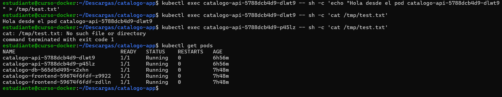

# Arquitecura - Cuestionario
## 1
### a
En el entorno de desarrollo, el propio servidor de vite actua como proxy, redirigiendo los pedidos a `VITE_API_URL`. En el entorno de produccion, el servidor de vite no está activamente funcionando, sinó que se usa un proxy (nginx) el cual redirige el trafico que incluye "/api" al host indicado en `API_HOST`.

### b
Debido a que el frontend actua como reverse proxy, y el navegador del usuario solo se comunica con nginx.
Para que el usuario pudiera comunicarse con con la api por su cuenta habría que configurar el backend para permitir el uso de CORS y configurar el ingress para que redirigija las entradas al frontend o a la api según corresponda.

### c
El unico autoescalador que puede ser nece necesario y se puede tener es el da la api.
- la base de datos es una sola y tiene que acceder a los mismos datos siempre, manteniendo el estado. Si se le asignara uno a la base de datos se puede dar el caso de que entre las dos creadas los productos almacenados no coincidan.
- La carga sobre el frontend es mucho menor que a la api, ya que lo único que hace es enviar un archivo estático o redirigir el pedido a la api.
## 2
Al tener varias replicas de la api no se puede garantizar que si se escribiera o almacenara informacion en un pod de catalogo-api se puede acceder desde los otros pods. Como la api es stateless, es decir no guarda información que será modificada y accedida por el usuario, esto no implica un problema. No solo esto, sino que al elminar un pod se perdería la informacion que esté almacenada en estos.
Es por esto que las imagenes se guardan en la base de datos y no en la api.
En la siguiente captura de pantalla se observa como se crea un archivo `test.txt` en un pod y luego se lo accede desde el mismo pod y desde otro distinto:

Como se observa, a ejecutar `cat` desde el contenedor que tiene el archivo se lo puede leer, pero desde el otro da error de archivo inexistente.

## 3 - Detalles de la base de dato
Para conectarse a la base de datos, la api usa un string de conexion de la forma: `mongodb://USUARIO:CONTRASENIA@IP:PUERTO/?authSource=admin`. A la hora de definir el string de conección, la api puede recibirlo listo o puede unir todos los componentes (usuario, contrasenia, etc...) por su cuenta. En este proyecto se decidió que la api reciba los componentes por separado, para una mayor legibilidad y facilidad de interpretación. 
Si se cambia la contreseña de la base de datos se debe modificar la el secreto que corresponde a `DB_PASSWORD` a la nueva contraseña.
Si se cambia el puerto en el que escucha la base de datos no es nesesario modificar ningun secreto, basta con cambiar las variables de entorno en el configmap.
Además, usando este metodo, quien realiza el deployment se desentiende de la sintaxis necesaria para conectarse a mongo, ya que de eso se encarga la propia api.
## 4
En un entorno real se necesita encriptar correctamente los secretos, y pasarlos como flags al ejecutar el comando `helm install` o `helm upgrade`.
La aplicación no implementa ningún tipo de backup de la base de datos. Corresponde periodicamente guardar una copia de los datos de la base de datos en un servidor aparte.
Un deplument no es una solución seria para darle escalabilidad a la base de dato debido a que surge un problema similar al explicado en el punto anterior: Al guardar una imagen en un pod de mongo, otro pod de mongo no puede acceder a esa imagen.
La opcion correcta es usar otro objeto de kubernetes, un stateful set el cual está pensado para darle persistencia a la información a los objetos, a diferencia de un deploy el cual esta pensado para que se pueda descartar sin problemas.

