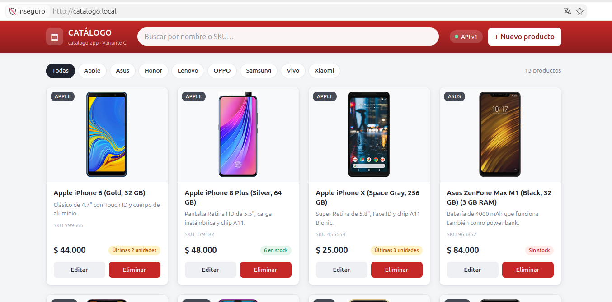
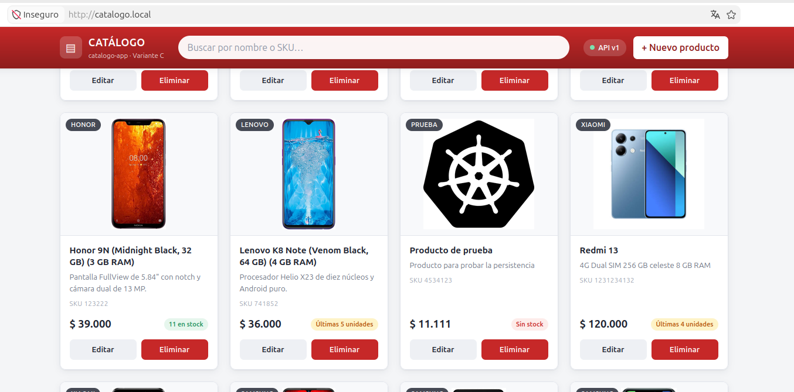
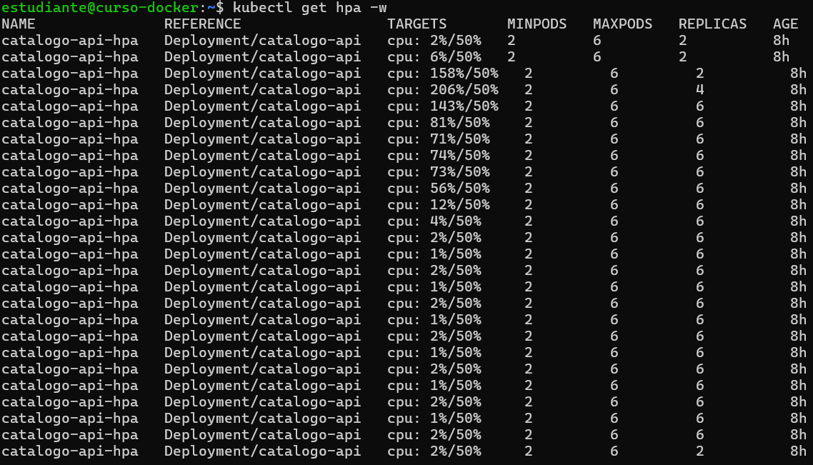
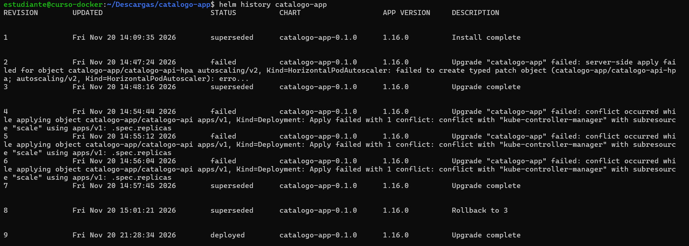
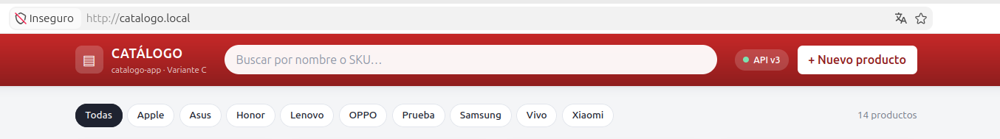
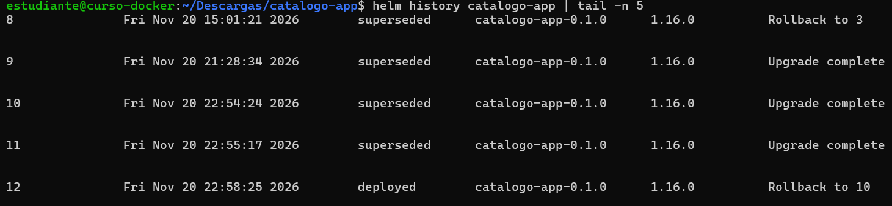
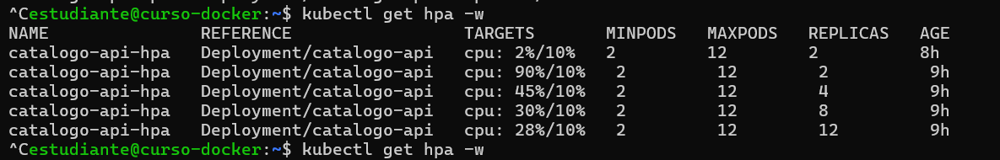
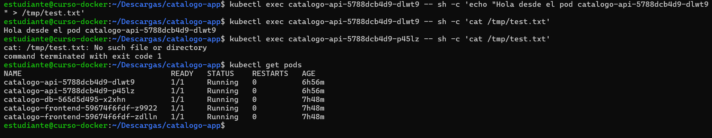

# Informe - catalogo app
Detalles de mi presentacion:
- en el directorio `practicos/` se encuentran los archivos en markdown hechos durante el desarrollo de los 8 practicos.
- Durante el cursado use `ssh` y la extension SSH FS, de visual studio code, para acceder a la máquina virtual desde windows por comodidad. Debido a estos las capturas de pantallas de los comandos ejecutados no tienen el "theme" de ubuntu.
## 1
Definido el ingress podemos acceder a la app mediante el enlace http://catalogo.local. como se observa en la imagen, se ven los productos de la demo:

Tambien se pueden cerar productos sin problemas, aqui se creo el producto "Redmi 13" y "producto de prueba".

## 2

Usando el comando:

        kubectl run carga --rm -it --restart=Never --image=busybox --         /bin/sh -c "while true; do wget -q -O- http://catalogo-api:8000/productos; done"
Podemos simular muchas pedidos en poco tiempo a la api. En `kubectl get hpa -w` podemos ver el consumo de CPU y la cantidad de replicas. cada unpequeño intervalo de tiempo.
En la siguiente imagen se obseva como hay dos replicas inicialmente, con un cosumo del 2~6 % del CPU, cuando este aumenta repentinamente (al ejecutar el comando anterior) a 150% rápidamente se crean cuatro replicas más, llegando a 6. Cuando la carga vuelva a reducirse por debaje del 50%, no se eliminan instaneamente, sino que se espera un par de minutos antes de regresar a 2 replicas.

## 3
Inicialmente `helm history catalogo-app` muestra 9 elementos obtenidos durante la realizacion del práctico (Varios fallaron por errores en los templates):

Para probar el deploy se cambia el tag de la api de v2 a v3, lo cual se ve reflejado en el indicador de version de la app.
Se usa el comando:

        helm upgrade catalogo-app catalogo-app/ --set api.image.tag=v3

Se observa que cambia de mostrar  `API v1` a mostrar `API v3`:

Luego usamos `helm rollback catalogo-app` el cual regresa a una instancia anterior y se observa como el indicador en la web regresa a `API v1`. usando `helm history` podemos ver las distintas revisiones y sus acciones. En este caso, la n° 11 es en donde se modifica el tag, la n°12 es el rollback y n°10 es cuando se tiene  `API v1` 

## 4
Modificando el values.yaml de:

        autoscaling:
          enabled: false
          minReplicas: 2
          maxReplicas: 6
          targetCPUUtilizationPercentage: 50
a:

        autoscaling:
          enabled: false
          minReplicas: 2
          maxReplicas: 12
          targetCPUUtilizationPercentage: 10

y ejecutando una prueba de carga se ve reflejada en la cantidad de replicas maximas y el porcentaje objetivo de CPU

## 5
En esta imagen se ve como se crea un archivo de texto en un pod, se puede leer los contenidos del mismo desde este este pod, pero al intentar acceder a archivo desde otro pod se obtiene error de archivo inexistente.

